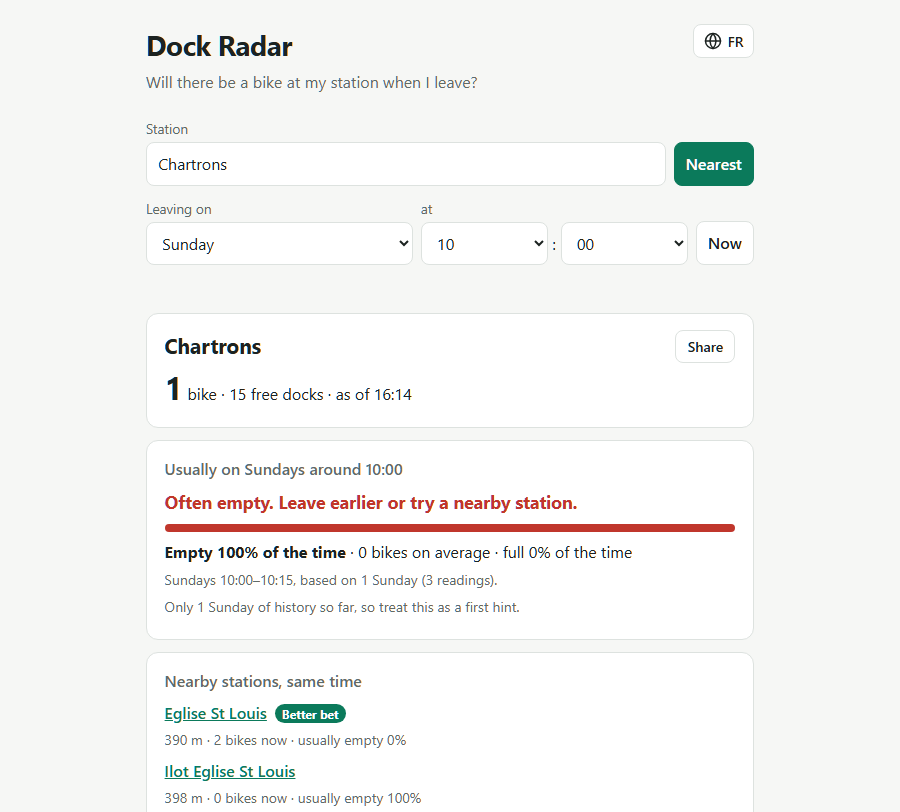

# Dock Radar

**Will there be a bike at my station when I leave?**

Bike-share apps show the live count. Dock Radar records every station's availability every few minutes
in Supabase and tells you how your station *usually* looks at this time on this day of the week:

> Monday 8:15, Chartrons: empty 40% of the time. Leave 5 minutes earlier or head to Jardin Public.

It works with any bike-share network that publishes a [GBFS v3](https://gbfs.org) feed.
The first feed is TBM Le Vélo in Bordeaux.

[](https://thomasmorgana.github.io/dock-radar/)

> **Status:** work in progress. Profiles need history. On day one there are only a few hours of data,
> and the "usually" numbers become meaningful after a week or two of collection.

## How it works

```
GBFS feed ──► Edge Function `ingest-gbfs` ──► Postgres (stations, station_snapshots)
                 ▲ every 5 min      │                 │               │ nightly rollup
             pg_cron + pg_net       │                 ▼               ▼
                                    │        station_profile()  station_hourly
                                    │                 │               │
                                    │                 ▼               │
                                    │      static page (supabase-js)  │
                                    │                 ▼               │
                                    └──► PostHog (optional) ◄─────────┘
                                 server events · page events · warehouse sync
```

- **Postgres:** `stations` and `station_snapshots` tables, with RLS set to public read and no public write
- **Edge Function** [`ingest-gbfs`](supabase/functions/ingest-gbfs): fetches the GBFS feeds and upserts stations and snapshots. Only the project's secret key can call it.
- **pg_cron + pg_net:** call the function every 5 minutes. The project URL and key come from Supabase Vault.
- **SQL function** [`station_profile(station_id, weekday, time)`](supabase/migrations/20260926182210_add_station_profile.sql): for that weekday and 15-minute local-time slot, returns the average bikes and docks, % of time empty or full, and how many past days the numbers are based on. Anyone can call it through the API; it's covered by [pgTAP tests](supabase/tests/station_profile.test.sql).

  ```bash
  curl -X POST "$SUPABASE_URL/rest/v1/rpc/station_profile" -H "apikey: $PUBLISHABLE_KEY" \
    -H "Content-Type: application/json" -d '{"p_station_id": "1", "p_weekday": 1, "p_time": "08:10"}'
  ```
- **Hourly rollup:** [`station_hourly`](supabase/migrations/20261011160000_add_station_hourly.sql) keeps one row per station, local date and hour
  (samples, how many were empty or full, average bikes), about 13 times fewer rows than `station_snapshots`. The `rollup-station-hourly`
  cron job fills in the previous local day every night at 03:47 UTC, and the migration backfills past days. Public read, like the other open-data
  tables, and covered by [pgTAP tests](supabase/tests/station_hourly.test.sql). It's what the PostHog data warehouse syncs (see below).
- **Front end** ([`docs/`](docs)): one static page, plain HTML and supabase-js, served by GitHub Pages. It reads the `station_latest` view and calls `station_profile`.
- **Email alerts** (optional): "email me the evening before if my station is usually empty at my departure time", sent with [Resend](https://resend.com).
  The page calls the [`alert-subscribe`](supabase/functions/alert-subscribe) function (double opt-in). Subscriptions live in a private table
  that the public API can't read or write. [`send-alerts`](supabase/functions/send-alerts) runs hourly from pg_cron and emails at 19:00 local time.
  Setup: a Resend API key, then `npx supabase secrets set --env-file <file>` with `RESEND_API_KEY`, `ALERT_FROM` and `SITE_URL`
  (see [`.env.example`](supabase/functions/.env.example)), then `npx supabase functions deploy alert-subscribe send-alerts`.
  Without a verified domain, Resend only delivers to your own address.

**Try it:** https://thomasmorgana.github.io/dock-radar/

## Analytics (optional)

Dock Radar can report to [PostHog](https://posthog.com) (EU cloud) to learn which stations people check, whether the
predictions match what they see, and which way of phrasing advice helps more. Without a PostHog token, the page and the
Edge Functions behave exactly as before and make no request to PostHog.

**What's tracked**
- **Page events:** `station_selected` (and how: picker, nearest, nearby, link, remembered), `profile_viewed` (the prediction shown),
  `nearby_station_clicked`, `nearest_used`, `share_clicked`, `time_changed`, `language_switched`, `alert_subscribe_submitted`, `alert_link_opened`.
  All go through [`docs/analytics.js`](docs/analytics.js), the only module that talks to PostHog.
- **Errors:** failed data loads and alert calls, tagged with where they happened.
- **Session replay and a survey** ("Does this match what you usually see at this station?"), only for visitors who accept.
- **An experiment:** the `profile-headline` flag shows half of visitors a one-line "what to do" headline above the verdict.
- **Server events:** `ingest_completed` / `ingest_failed` from `ingest-gbfs`, `alert_sent` / `alert_send_failed` from `send-alerts`.
- **Data warehouse:** PostHog syncs `stations` and `station_hourly` (never `station_snapshots`, too big, or `alert_subscriptions`, private)
  to compare each "now" prediction with what the station actually did.

**What isn't**
- No email address, confirmation or unsubscribe token, or location is ever sent. Nobody is identified: every visitor stays anonymous.
- A consent banner asks first. Until the visitor chooses, nothing is sent and PostHog sets no cookies. Decline gives anonymous,
  cookieless events only, without replay or surveys. Replays mask every input, and the alert email field is excluded on top of that.

**Turn it on**
1. Create a PostHog project and turn on **Cookieless server hash mode** (Project settings → Web analytics), plus replay and surveys.
2. Put the project token (`phc_…`, public by design) in [`docs/config.js`](docs/config.js) as `POSTHOG_TOKEN`. Analytics stays off on
   `localhost` unless you set `POSTHOG_ON_LOCALHOST = true`; local events are tagged `env: local`.
   Only `thomasmorgana.github.io` is tagged `env: production`, any other host `env: staging`: change the hostname in
   [`docs/analytics.js`](docs/analytics.js) to yours.
3. For server events: `npx supabase secrets set POSTHOG_TOKEN=phc_… POSTHOG_HOST=https://eu.i.posthog.com`,
   then `npx supabase functions deploy ingest-gbfs send-alerts`.
4. For the warehouse: create a read-only role. RLS hides every row from it unless it gets its own policies:

   ```sql
   create role posthog_reader with login password '<choose one>';
   grant usage on schema public to posthog_reader;
   grant select on public.stations, public.station_hourly to posthog_reader;
   create policy "PostHog can read stations" on public.stations for select to posthog_reader using (true);
   create policy "PostHog can read hourly rollups" on public.station_hourly for select to posthog_reader using (true);
   ```

   Then add a Supabase source in PostHog (Data pipelines → Sources) with the **Session pooler** host and user
   `posthog_reader.<project-ref>`. Sync `stations` as a full refresh and `station_hourly` incrementally on `rolled_up_at`, with
   `station_id`, `local_date` and `local_hour` as the primary key. Any other key merges rows. Compare the synced row count with the table's.

**Limits**
- With a few visitors a week, the experiment won't reach statistical significance.
- Predictions need history, so "prediction vs reality" only means something after a few weeks, and it only joins past days
  (the rollup runs at night).
- Visitors who decline get a cookieless ID that changes daily, so their data is noisier and they can switch experiment variant.

## Install in your own Supabase project

About 15 minutes, for any city with a GBFS v3 feed. Installing with an AI agent? Point it to [AGENTS.md](AGENTS.md).

**You need:**
- a Supabase project (the free tier works)
- Node.js, so you can run the Supabase CLI with `npx supabase`, or the [standalone CLI](https://supabase.com/docs/guides/local-development/cli/getting-started)
- your network's GBFS v3 discovery URL (`gbfs.json`). MobilityData keeps a [list of public feeds](https://github.com/MobilityData/gbfs/blob/master/systems.csv). Check that its `version` is `3.x`.

### 1. Database

Clone the repo, log in, link it to your project and apply the migrations.
The link command asks for your database password.

```bash
git clone https://github.com/ThomasMorgana/dock-radar.git && cd dock-radar
npx supabase login
npx supabase link --project-ref <project-ref>
npx supabase db push
```

This creates the tables, `station_profile()`, the `station_latest` view, a cron job that runs every 5 minutes,
and the nightly `station_hourly` rollup.

### 2. Ingestion function

```bash
npx supabase secrets set GBFS_URL="https://.../gbfs.json"
npx supabase functions deploy ingest-gbfs
```

### 3. Let the cron job call the function

The cron job reads your project URL and secret key from Vault. Run this once in the SQL editor.
Create a dedicated secret key for it under **Project Settings → API Keys**, named `pg-cron` for example.
That way you can rotate or revoke it without touching anything else.

```sql
select vault.create_secret('https://<project-ref>.supabase.co', 'project_url');
select vault.create_secret('<your sb_secret_... key>', 'secret_key');
```

Until this is done, the cron job runs but fails.

### 4. Check that data is coming in

Within 5 minutes, each poll should add one row per station:

```sql
select observed_at, count(*) from station_snapshots group by 1 order by 1 desc limit 5;
```

If nothing arrives, these two queries show why:

```sql
select status, return_message, start_time from cron.job_run_details order by start_time desc limit 5;
select status_code, content, error_msg from net._http_response order by id desc limit 5;
```

### 5. Front end

Edit [`docs/config.js`](docs/config.js):
- `SUPABASE_URL` and `SUPABASE_PUBLISHABLE_KEY`: the publishable key is designed to be public, and RLS only allows reading.
- `TIMEZONE`: your network's time zone, for example `America/New_York`. It's passed to `station_profile`.
- `POSTHOG_TOKEN`: empty it, or put your own PostHog token (see [Analytics](#analytics-optional)). Otherwise your page reports to this repo's PostHog project.

Also update the attribution in the footer of [`docs/index.html`](docs/index.html) to credit your data provider.
Then host `docs/` anywhere static. On GitHub Pages: **Settings → Pages → Deploy from a branch → `main` / `/docs`**.

### Good to know

- **History takes time.** The "usually" numbers need a few weeks of the same weekday to be meaningful.
- **Storage grows steadily.** Each snapshot row takes about 100 bytes, including its index. A 230-station network adds about
  7 MB a day, or about 200 MB a month, so the free tier's 500 MB lasts roughly 2–3 months. `station_hourly` keeps an hourly summary
  of everything, but nothing deletes old snapshots yet: `station_profile` works on 15-minute slots and still reads them (see "Ideas for v2").
- **Free-tier projects pause when inactive.** Check your project's status now and then, because collection stops while it's paused.
- **To stop collecting:** `select cron.unschedule('ingest-gbfs');`

### Local development

```bash
npx supabase start                 # needs Docker
npx supabase functions serve --env-file supabase/functions/.env   # copy .env.example first
npx supabase test db               # pgTAP tests
```

On the local stack, the Vault `project_url` is `http://kong:8000`, and the secret key comes from `npx supabase status`.

## Ideas for v2

- **Read the time zone from the feed.** `station_profile` defaults to `Europe/Paris`, so other cities have to pass
  `p_timezone`. GBFS `system_information` publishes the network's `timezone`. Ingestion could store it, and the
  profile would then be correct everywhere without any configuration.
- **Delete old snapshots.** The hourly rollup (`station_hourly`) exists now. With 15-minute slots in it as well,
  `station_profile` could read the rollup for older days, raw snapshots could be kept for a few weeks only,
  and storage would stop growing with time.

## Data & attribution

Station data: **Bordeaux Métropole / TBM**, open data under the
[Licence Ouverte / Open Licence](https://www.etalab.gouv.fr/licence-ouverte-open-licence/).

## License

[MIT](LICENSE) © ThomasMorgana
